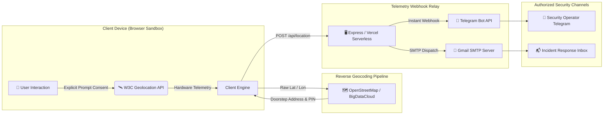

<div align="center">

# 🛡️ Geolocation Telemetry & Webhook Relay
### *Security Awareness PoC & Incident Response Telemetry Pipeline*

**An authorized OSINT, cybersecurity awareness, and emergency telemetry research system demonstrating HTML5 Geolocation API telemetry capture, multi-tier reverse geocoding, and automated Telegram bot webhook relays.**

---

[](LICENSE)
[](LICENSE)
[](https://nodejs.org/)
[](https://expressjs.com/)
[](https://react.dev/)
[](https://tailwindcss.com/)
[](https://core.telegram.org/bots)
[](https://vercel.com/)

[Security Notice](#-security-awareness--ethical-use-notice) • [Overview](#-overview) • [Architecture](#-telemetry-architecture) • [Getting Started](#-getting-started) • [Configuration](#-configuration--environment-variables) • [Deployment](#-deployment) • [API Docs](#-api-specification)

</div>

---

> [!IMPORTANT]
> ### 🛡️ Security Awareness & Ethical Use Notice
> This repository is a **Security Awareness Proof of Concept (PoC)** and educational demonstration designed for:
> 1. **Defensive Cybersecurity Education**: Demonstrating how device telemetry and browser permissions operate under the W3C Geolocation API standard.
> 2. **Emergency Incident Response**: Rapid real-time telemetry dispatch to pre-configured security operators or incident responders via webhook relays.
> 3. **Authorized Audit Testing**: Evaluating user awareness regarding browser permission dialogues and location sharing risks.
> 
> **Strict Compliance**: The HTML5 Geolocation API enforces explicit user opt-in prompt consent at the browser level before any coordinate data can be captured. This tool strictly adheres to user consent requirements and does not bypass platform security sandboxes.

---

## 🔍 Overview

**Geolocation Telemetry & Webhook Relay** demonstrates a modern telemetry pipeline that captures browser-permitted device telemetry (GPS coordinates, GNSS accuracy tier, altitude, heading, movement velocity, IP address), processes the telemetry through reverse geocoding engines (OpenStreetMap Nominatim & BigDataCloud), and delivers instant structured incident alerts through:

1. **Telegram Bot Webhook Relay**: Direct Markdown/HTML alerts featuring dynamic map links, turn-by-turn routes, and satellite perspectives.
2. **SMTP Email Dispatcher**: Structured HTML incident reports containing device telemetry and network audit metadata.
3. **Cosmic Glassmorphic Interface**: Interactive React 19 UI illustrating visual consent states and real-time sensory feedback.

---

## ⚡ Telemetry Precision Classification

Telemetry fixes are categorized based on hardware satellite and network triangulation precision tiers:

| Precision Tier | Error Radius | Typical Source | Resolution Level |
| :--- | :--- | :--- | :--- |
| **🛰️ Satellite GNSS Lock** | $\le 10\text{ meters}$ | Hardware GNSS / GPS L1/L5 | Doorstep / Exact Building |
| **📡 High-Accuracy GPS / Wi-Fi** | $10\text{m} - 35\text{m}$ | Differential GPS / Wi-Fi RTT | Street & Plot Boundary |
| **📶 Wi-Fi Triangulation** | $35\text{m} - 100\text{m}$ | Multi-BSSID Triangulation | Neighborhood / Block Level |
| **🗼 Cellular / ISP Hub** | $> 100\text{ meters}$ | Cell-ID / Gateway IP Geolocation | City / Metropolitan Area |

---

## 🏗️ Telemetry Architecture



---

## 📁 Repository Structure

```text
Location-Tracker/
├── LOcation/                  # Telemetry relay backend & application core
│   ├── frontend-src/          # React 19 + Vite + Tailwind source code
│   │   ├── src/               # Telemetry triggers, animations & UI logic
│   │   └── package.json       # Frontend dependencies
│   ├── server.js              # Express telemetry relay & webhook router
│   ├── get-chat-id.js         # Telegram Chat ID discovery utility
│   ├── package.json           # Backend dependencies (express, nodemailer, cors)
│   ├── vercel.json            # Vercel serverless deployment config
│   └── index.html             # Client entry point
├── assets/                    # Production compiled client bundles
├── .env.example               # Environment variable template
├── .gitignore                 # Credential protection rules
├── index.html                 # Production root landing page
├── LICENSE                    # MIT Open Source License
└── README.md                  # Security & technical documentation
```

---

## 🚀 Getting Started

### 1. Prerequisites

- **Node.js** v18.0.0 or higher ([Download Node.js](https://nodejs.org/))
- **npm** or **pnpm**
- A Telegram account (to receive webhook alerts)
- A Gmail account with 2FA enabled (optional, for email delivery)

### 2. Clone the Repository

```bash
git clone https://github.com/Zwitter01/Location-Tracker.git
cd Location-Tracker
```

### 3. Install Dependencies

```bash
# Install backend relay dependencies
cd LOcation
npm install

# (Optional) If building frontend from source
cd frontend-src
npm install
cd ..
```

---

## ⚙️ Configuration & Environment Variables

Copy the provided example file to create your local `.env`:

```bash
cp .env.example .env
```

Set the following variables in `LOcation/.env`:

```env
# Server Port
PORT=3000

# Telegram Bot Webhook Relay
TELEGRAM_BOT_TOKEN=YOUR_TELEGRAM_BOT_TOKEN
TELEGRAM_CHAT_ID=YOUR_TELEGRAM_CHAT_ID

# SMTP Notification Settings (Gmail)
EMAIL_SERVICE=gmail
EMAIL_USER=your_email@gmail.com
EMAIL_PASS=your_16_character_app_password
EMAIL_TO=incident_response@yourdomain.com
```

### 🤖 Telegram Webhook Setup

1. Message **[@BotFather](https://t.me/BotFather)** on Telegram and create a new bot using `/newbot`.
2. Copy the **HTTP API Token** and assign it to `TELEGRAM_BOT_TOKEN`.
3. Start a conversation with your bot (`/start`).
4. Execute the automated Chat ID resolver:
   ```bash
   npm run get-chat-id
   ```
   *The script retrieves your chat identifier, updates `.env`, and tests webhook communication.*

### 📧 SMTP Setup (Gmail)

1. Open your **[Google Account Security](https://myaccount.google.com/security)** panel.
2. Ensure **2-Step Verification** is enabled.
3. Generate a dedicated 16-character key under **[App Passwords](https://myaccount.google.com/apppasswords)**.
4. Set `EMAIL_PASS` to this generated key.

---

## 💻 Running the Relay

### Local Server Execution

```bash
npm start
```
The server will bind to `http://localhost:3000`.

> [!TIP]
> **Mobile HTTPS Requirement**: Modern mobile web browsers enforce Secure Contexts (`HTTPS`) for the Geolocation API. To test telemetry from a physical mobile device locally:
> ```bash
> npx localtunnel --port 3000
> ```
> Load the generated HTTPS URL on your testing device.

---

## ☁️ Deployment

### Vercel Serverless Deployment

1. Connect the repository to your [Vercel Dashboard](https://vercel.com).
2. Configure **Environment Variables** in Vercel Project Settings:
   - `TELEGRAM_BOT_TOKEN`
   - `TELEGRAM_CHAT_ID`
   - `EMAIL_USER`
   - `EMAIL_PASS`
   - `EMAIL_TO`
3. Deploy! Vercel handles HTTPS provisioning and serverless execution automatically.

---

## 📡 API Specification

### `POST /api/location`
Ingests telemetry packets and triggers webhook relays.

#### Request Body
```json
{
  "latitude": 26.7606,
  "longitude": 83.3732,
  "accuracy": 7.2,
  "altitude": 82.0,
  "speed": 0.0,
  "heading": 0,
  "source": "Hardware GNSS Satellite"
}
```

#### Response (`200 OK`)
```json
{
  "success": true,
  "message": "Telemetry received and relayed successfully",
  "coordinates": {
    "latitude": 26.7606,
    "longitude": 83.3732,
    "accuracy": 7.2
  },
  "address": "Gorakhnath Temple Rd, Gorakhpur, Uttar Pradesh, 273015",
  "postcode": "273015",
  "delivery": {
    "telegram": { "attempted": true, "success": true, "note": "Delivered to Telegram" },
    "email": { "attempted": true, "success": true, "note": "Delivered to recipient" }
  }
}
```

### `GET /api/status`
Returns server operational health and integration readiness.

---

## ⚖️ Legal & Compliance Disclaimer

- **Authorized Testing Only**: This software must only be used in authorized penetration tests, personal emergency systems, or structured security awareness demonstrations.
- **Privacy First**: Telemetry is relayed directly to the operator's configured endpoints and is never logged to external third parties.
- **No Warranty**: Provided under the MIT License "as is", without warranty of any kind. Authors assume no liability for misuse.

---

## 📄 License

Distributed under the **MIT License**. See [LICENSE](LICENSE) for details.

---

<div align="center">
  Maintained by <a href="https://github.com/Zwitter01"><b>Vishal Prajapati</b></a>
</div>
