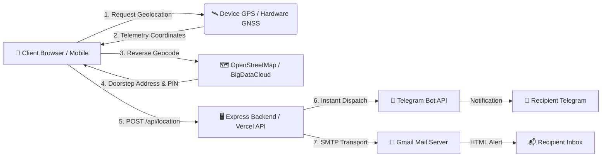

<div align="center">

# 🛰️ Location Tracker & Real-Time Dispatcher

**High-precision GPS intelligence engine with instant Telegram bot dispatches, rich HTML email alerts, doorstep reverse geocoding, and an immersive cosmic glassmorphic UI.**

---

[](LICENSE)
[](https://nodejs.org/)
[](https://expressjs.com/)
[](https://react.dev/)
[](https://tailwindcss.com/)
[](https://core.telegram.org/bots)
[](https://vercel.com/)

[Features](#-features) • [Architecture](#-architecture) • [Getting Started](#-getting-started) • [Telegram Setup](#-telegram-bot-setup) • [Email Setup](#-email-setup) • [Deployment](#-cloud-deployment) • [API Docs](#-api-reference)

</div>

---

## 🌟 Overview

**Location Tracker** is a full-stack real-time geolocation tracking and notification system. When triggered on a smartphone or browser, it captures device telemetry (high-accuracy GPS coordinates, altitude, heading, movement speed, IP address), translates the raw latitude/longitude into a human-readable doorstep street address, and immediately dispatches alerts across **Telegram** and **Email**.

Featuring a dark glassmorphic cosmic interface with particle simulations and sound effects, it provides both client-side and server-side notification pipelines.

---

## ✨ Features

- 🎯 **Doorstep GPS Accuracy**: Hardware satellite GNSS lock with dynamic precision classification:
  - 🛰️ **Doorstep Satellite Lock** ($\le 10\text{m}$)
  - 📡 **High-Accuracy GPS / Wi-Fi** ($10\text{m} - 35\text{m}$)
  - 📶 **Wi-Fi Triangulation** ($35\text{m} - 100\text{m}$)
  - 🗼 **Cell-Tower / ISP Hub** ($> 100\text{m}$)
- 🤖 **Instant Telegram Bot Dispatch**:
  - Live 3D Rooftop Satellite View (Google Maps)
  - Turn-by-Turn GPS Navigation route
  - Google 360° Street View integration
  - OpenStreetMap house-number overlay
- 📧 **Automated Rich HTML Email Notifications**:
  - Styled responsive alert template via Gmail SMTP (`nodemailer`)
  - Full telemetry breakdown (coordinates, accuracy, timestamp, IP, user-agent)
- 🏠 **Smart Reverse Geocoding**:
  - Automatically queries OpenStreetMap Nominatim & BigDataCloud APIs
  - Extracts exact house number, road, locality/colony, city, state, and postal PIN code
- 🌌 **Cosmic Glassmorphic Frontend**:
  - Modern React 19 + TypeScript + Tailwind CSS UI
  - Interactive parallax stars, deep-space nebulas, and audio feedback
- ⚡ **Deploy Anywhere**:
  - Works locally, behind tunnel (Localtunnel/Ngrok), or deployed serverless on **Vercel**

---

## 🏗️ Architecture



---

## 📁 Repository Structure

```text
Location-Tracker/
├── LOcation/                  # Core backend & application source
│   ├── frontend-src/          # React 19 + Vite + Tailwind source code
│   │   ├── src/               # Components, animations & audio logic
│   │   ├── package.json       # Frontend dependencies
│   │   └── vite.config.ts     # Vite configuration
│   ├── server.js              # Express API server (Telegram & Email engine)
│   ├── get-chat-id.js         # Telegram Chat ID discovery utility
│   ├── package.json           # Backend dependencies (express, nodemailer, cors)
│   ├── vercel.json            # Vercel serverless configuration
│   └── index.html             # Application entry point
├── assets/                    # Optimized frontend production bundles
├── .env.example               # Template for environment variables
├── .gitignore                 # Secure ignore rules (protects credentials)
├── index.html                 # Production root landing page
├── LICENSE                    # MIT License
└── README.md                  # Comprehensive documentation
```

---

## 🚀 Getting Started

### 1. Prerequisites

- **Node.js** v18.0.0 or higher ([Download Node.js](https://nodejs.org/))
- **npm** or **pnpm** installed
- A **Telegram account** (for instant bot alerts)
- A **Gmail account** (optional, for email delivery)

### 2. Clone the Repository

```bash
git clone https://github.com/Zwitter01/Location-Tracker.git
cd Location-Tracker
```

### 3. Install Dependencies

```bash
# Install backend dependencies
cd LOcation
npm install

# (Optional) If you want to modify frontend source
cd frontend-src
npm install
cd ..
```

### 4. Configure Environment Variables

Create a `.env` file inside the `LOcation/` directory (or use the root `.env.example` as reference):

```bash
cp .env.example .env
```

Fill in your credentials:

```env
PORT=3000

# Telegram Bot Settings
TELEGRAM_BOT_TOKEN=your_telegram_bot_token_here
TELEGRAM_CHAT_ID=your_telegram_chat_id_here

# Email Notification Settings (Gmail)
EMAIL_SERVICE=gmail
EMAIL_USER=your_email@gmail.com
EMAIL_PASS=your_16_character_app_password
EMAIL_TO=recipient_email@gmail.com
```

---

## 🤖 Telegram Bot Setup

1. Open Telegram and search for **[@BotFather](https://t.me/BotFather)**.
2. Send `/newbot` and follow the on-screen prompts to choose a name and username for your bot.
3. BotFather will provide an **HTTP API Token** (e.g. `1234567890:ABCdefGhIJKlmNoPQRsTUVwxyZ`).
4. Paste this token into your `.env` as `TELEGRAM_BOT_TOKEN`.
5. Open your newly created bot in Telegram and tap **Start** (or send any text message).
6. To automatically find your numeric Chat ID, run:
   ```bash
   npm run get-chat-id
   ```
   *This tool queries Telegram, detects your Chat ID, automatically updates `.env`, and sends a test message to confirm!*

---

## 📧 Email Setup (Gmail SMTP)

To enable email notifications:

1. Visit your **[Google Account Security](https://myaccount.google.com/security)** dashboard.
2. Turn **2-Step Verification** ON.
3. Navigate to **[App Passwords](https://myaccount.google.com/apppasswords)**.
4. Generate a new password under the custom name `Location Tracker`.
5. Copy the 16-character code (e.g., `abcd efgh ijkl mnop`).
6. Set `EMAIL_PASS=your_app_password` in your `.env` file.

---

## 💻 Running Locally

Start the Express backend and static frontend:

```bash
npm start
```

Visit **`http://localhost:3000`** in your browser.

> [!TIP]
> Modern mobile browsers require **HTTPS** for the Geolocation API. To test pinpoint GPS from your smartphone, create a secure tunnel:
> ```bash
> npx localtunnel --port 3000
> ```
> Open the generated `https://*.loca.lt` URL on your phone!

---

## ☁️ Cloud Deployment

### Deploying to Vercel (Recommended)

1. Push this project to GitHub.
2. Go to [Vercel Dashboard](https://vercel.com/dashboard) and click **Add New Project**.
3. Import your `Location-Tracker` repository.
4. Set the **Root Directory** to `LOcation` (or deploy from root with `LOcation/vercel.json`).
5. Under **Environment Variables**, add:
   - `TELEGRAM_BOT_TOKEN`
   - `TELEGRAM_CHAT_ID`
   - `EMAIL_USER`
   - `EMAIL_PASS`
   - `EMAIL_TO`
6. Click **Deploy**! Automatic HTTPS is enabled instantly.

---

## 📡 API Reference

### 1. `POST /api/location`
Receives device coordinates and dispatches notifications.

**Request Payload:**
```json
{
  "latitude": 26.7606,
  "longitude": 83.3732,
  "accuracy": 8.5,
  "altitude": 78.2,
  "speed": 0.0,
  "heading": 180,
  "source": "Hardware GNSS Satellite"
}
```

**Response (`200 OK`):**
```json
{
  "success": true,
  "message": "Location received successfully!",
  "coordinates": {
    "latitude": 26.7606,
    "longitude": 83.3732,
    "accuracy": 8.5
  },
  "address": "Gorakhnath Temple Rd, Gorakhpur, Uttar Pradesh, 273015",
  "postcode": "273015",
  "googleMapsUrl": "https://www.google.com/maps/place/26.7606,83.3732/...",
  "delivery": {
    "telegram": { "attempted": true, "success": true, "note": "Delivered to Telegram" },
    "email": { "attempted": true, "success": true, "note": "Delivered to recipient" }
  }
}
```

### 2. `GET /api/status`
Checks server health and active notification integrations.

---

## 🛡️ Security & Privacy Notice

- **User Consent**: The HTML5 Geolocation API requires explicit user permission before coordinates can be captured.
- **Credential Protection**: Never commit your `.env` file or bot tokens to version control. The `.gitignore` included in this repository safeguards private credentials.
- **Intended Use**: This software is designed for personal safety monitoring, authorized asset tracking, and educational demonstrations.

---

## 📄 License

Distributed under the **MIT License**. See [LICENSE](LICENSE) for details.

---

<div align="center">
  Crafted with ❤️ by <a href="https://github.com/Zwitter01"><b>Vishal Prajapati</b></a>
</div>
